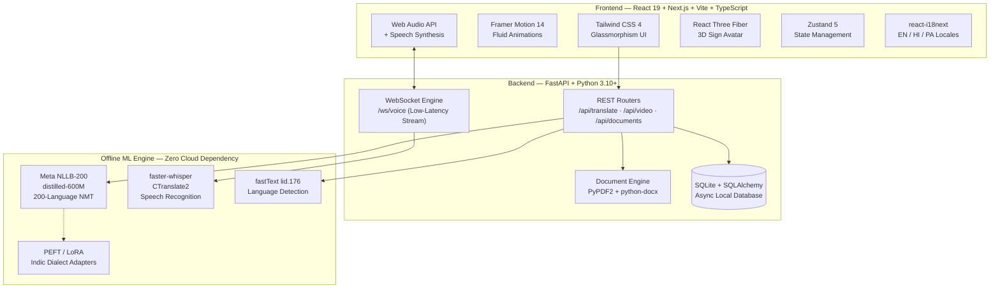

<div align="center">


# LinguaBridge

### 🧠 Offline Neural Translation & Multimedia Intelligence Platform

<br/>

[](https://python.org)
[](https://fastapi.tiangolo.com)
[](https://react.dev)
[](https://nextjs.org)
[](https://typescriptlang.org)
[](https://tailwindcss.com)
[](https://threejs.org)
[](https://www.framer.com/motion/)
[](https://www.docker.com)
[](LICENSE)
[](#-why-linguabridge)

<br/>

> **A privacy-first, zero-cloud neural translation studio powered by Meta's NLLB-200 and OpenAI's Whisper.**
> Real-time multi-speaker voice conversations · Cinema-grade dual-subtitle video captioning · Structured document translation · 3D sign language avatar — all running 100% on your local machine.

<br/>

[Why LinguaBridge?](#-why-linguabridge) · [Features](#-features) · [Architecture](#-system-architecture) · [Quick Start](#-quick-start) · [API](#-api-reference) · [Languages](#-supported-languages-63) · [Roadmap](#-roadmap)

<br/>

---

</div>

## 🎯 Why LinguaBridge?

Most translation tools depend on cloud APIs — Google Cloud Translation, OpenAI, DeepL — introducing **latency**, **recurring billing**, **privacy risks**, and **poor handling of regional Indian dialects**. LinguaBridge takes a fundamentally different approach:

| Problem | Cloud-Based Tools | LinguaBridge |
|---------|:----------------:|:------------:|
| **Privacy** | ❌ Data sent to external servers | ✅ 100% local inference, zero telemetry |
| **Cost** | ❌ Pay-per-character / monthly subscriptions | ✅ Completely free, forever |
| **Internet Required** | ❌ Always online | ✅ Works fully offline |
| **Indian Language Quality** | ❌ Generic / mistranslation-prone | ✅ Authentic Gurmukhi phonetics, Devanagari maps, cultural greeting normalization |
| **Voice Conversation** | ❌ Single direction, no tone control | ✅ Bi-directional with gender, age & cultural tone modulation |
| **Video Captioning** | ❌ Separate tools, no dual subtitles | ✅ Integrated cinema player with Original + Translated dual captions |

<br/>

## ✨ Features

<table>
<tr>
<td width="50%">

### 🔤 Neural Text Translation
- Real-time debounced translation across **63+ languages**
- Auto-detect source language with confidence score
- One-click copy, language swap, and history tracking

</td>
<td width="50%">

### 🎙️ Voice Translation
- Continuous speech-to-text with instant neural synthesis
- Live audio waveform visualization
- Single-playback guarantee with zero echo/loopback

</td>
</tr>
<tr>
<td>

### 💬 Conversation Studio
- Two-person split-screen dialogue (Speaker A ↔ Speaker B)
- **Male / Female** voice selection per speaker
- **Young / Natural / Mature** age modulation
- Cultural tone: Casual · Formal · Indian Tone · Auto

</td>
<td>

### 🎬 Cinema Video Studio
- Upload video → AI transcription + subtitle alignment
- **Dual subtitles**: Original language + Translated language
- Interactive seeking transcript with timestamps
- One-click export: **SRT · VTT · TXT**

</td>
</tr>
<tr>
<td>

### 📄 Document Translation
- Side-by-side dual-panel layout preview
- Paragraph-level structure preservation
- Supports **PDF · DOCX · TXT** with multi-format export

</td>
<td>

### 🤖 3D Sign Language Avatar
- Procedural 3D humanoid avatar (React Three Fiber)
- ASL / ISL gloss sequence interpretation
- Timeline-synchronized gesture playback

</td>
</tr>
<tr>
<td>

### 🔬 Model Lab
- Side-by-side model benchmarking suite
- **BLEU · chrF++ · METEOR** evaluation metrics
- Compare Base NLLB vs LoRA fine-tuned adapters

</td>
<td>

### 📊 Analytics Dashboard
- Total words translated, latency tracking
- Daily volume trends and top language pairs
- Fully local telemetry — no data leaves your machine

</td>
</tr>
</table>

<br/>

## 🏗️ System Architecture



<br/>

## 🛠️ Tech Stack

<table>
<tr>
<th>Layer</th>
<th>Technology</th>
<th>Purpose</th>
</tr>
<tr>
<td rowspan="8"><strong>Frontend</strong></td>
<td></td>
<td>Component-based UI framework</td>
</tr>
<tr>
<td></td>
<td>SSR-compatible React framework architecture</td>
</tr>
<tr>
<td></td>
<td>Lightning-fast HMR build toolchain</td>
</tr>
<tr>
<td></td>
<td>End-to-end type safety</td>
</tr>
<tr>
<td></td>
<td>Utility-first styling with glassmorphism design system</td>
</tr>
<tr>
<td></td>
<td>Production-grade animations and micro-interactions</td>
</tr>
<tr>
<td></td>
<td>3D sign language avatar via React Three Fiber</td>
</tr>
<tr>
<td></td>
<td>Lightweight global state management</td>
</tr>
<tr>
<td rowspan="5"><strong>Backend</strong></td>
<td></td>
<td>High-performance async REST + WebSocket API</td>
</tr>
<tr>
<td></td>
<td>Backend runtime environment</td>
</tr>
<tr>
<td></td>
<td>Async ORM with aiosqlite for local persistence</td>
</tr>
<tr>
<td></td>
<td>Schema validation and settings management</td>
</tr>
<tr>
<td></td>
<td>Low-latency bi-directional voice streaming</td>
</tr>
<tr>
<td rowspan="4"><strong>ML / AI</strong></td>
<td></td>
<td>200-language neural machine translation (distilled-600M)</td>
</tr>
<tr>
<td></td>
<td>faster-whisper (CTranslate2) for speech recognition & alignment</td>
</tr>
<tr>
<td></td>
<td>lid.176 instant language identification</td>
</tr>
<tr>
<td></td>
<td>Parameter-efficient fine-tuning for Indic dialect specialization</td>
</tr>
<tr>
<td rowspan="2"><strong>Infrastructure</strong></td>
<td></td>
<td>Containerized local deployment</td>
</tr>
<tr>
<td></td>
<td>Audio extraction from video files</td>
</tr>
</table>

<br/>

## 📁 Project Structure

```
LinguaBridge/
├── 📂 frontend/                          # React 19 + Next.js + Vite + TypeScript
│   ├── src/
│   │   ├── components/
│   │   │   ├── layout/                   # Header, Sidebar, MobileNav
│   │   │   ├── translation/             # LanguagePicker, WaveformVisualizer
│   │   │   ├── video/                   # CinemaPlayer, TranscriptPanel, ExportPanel
│   │   │   └── common/                  # CommandPalette, ErrorBoundary, GlassCards
│   │   ├── pages/
│   │   │   ├── TranslatorPage.tsx       # Text · Voice · Conversation · Documents
│   │   │   ├── VideoStudioPage.tsx      # Video captioning & 3D avatar workspace
│   │   │   ├── ModelLabPage.tsx         # BLEU / chrF++ / METEOR benchmarks
│   │   │   ├── HistoryPage.tsx          # Searchable translation history
│   │   │   ├── DashboardPage.tsx        # Analytics & usage visualization
│   │   │   └── SettingsPage.tsx         # Theme, voice persona & model config
│   │   ├── store/                       # Zustand stores (translation, video, settings)
│   │   ├── lib/                         # API client, TTS engine, Gurmukhi phonetics
│   │   └── i18n/                        # EN · HI · PA locale files
│   └── vite.config.ts
│
├── 📂 backend/                           # FastAPI + Python 3.10+
│   ├── app/
│   │   ├── main.py                      # Application factory & lifespan events
│   │   ├── config.py                    # Pydantic Settings & environment config
│   │   ├── database.py                  # Async SQLAlchemy + aiosqlite
│   │   ├── ml/
│   │   │   ├── model_manager.py         # Singleton ML model loader & warm-up
│   │   │   └── languages.py            # 63 language definitions & NLLB codes
│   │   ├── routers/                     # translate · voice · video · documents · history · analytics
│   │   └── services/
│   │       ├── translation.py           # NLLB translation + tone modulation + colloquial maps
│   │       ├── video_processor.py       # Two-pass Whisper transcription & subtitle pipeline
│   │       ├── document.py              # Multi-format document parser & translator
│   │       └── subtitle.py             # SRT · VTT · dual-subtitle generator
│   └── requirements.txt
│
├── 📂 ml/                                # Fine-tuning & evaluation pipeline
│   ├── configs/training_config.yaml     # LoRA / PEFT hyperparameters
│   ├── scripts/
│   │   ├── finetune_nllb.py             # LoRA fine-tuning for Indic language pairs
│   │   ├── evaluate_model.py            # BLEU · chrF++ · METEOR validation
│   │   └── export_ctranslate2.py        # Quantize to int8 for CPU inference
│   └── model_card.md                    # Evaluation benchmarks
│
├── 🐳 docker-compose.yml                # Containerized deployment
├── ⚡ start.bat                          # One-click Windows launcher
├── ⚡ start.sh                           # One-click Linux/macOS launcher
└── 📄 README.md
```

<br/>

## 🚀 Quick Start

### Prerequisites

| Requirement | Version | Notes |
|-------------|---------|-------|
| **Python** | 3.10+ (3.12 recommended) | Backend runtime |
| **Node.js** | 18+ (20 recommended) | Frontend build toolchain |
| **FFmpeg** | Latest | Optional — required for video audio extraction |

### ⚡ One-Click Launch

<table>
<tr>
<td>

**Windows**
```cmd
git clone https://github.com/vivek-ash/LinguaBridge.git
cd LinguaBridge
start.bat
```

</td>
<td>

**Linux / macOS**
```bash
git clone https://github.com/vivek-ash/LinguaBridge.git
cd LinguaBridge
chmod +x start.sh && ./start.sh
```

</td>
</tr>
</table>

### 🛠️ Manual Setup

<details>
<summary><b>Step-by-step installation guide</b></summary>

#### 1. Clone the repository
```bash
git clone https://github.com/vivek-ash/LinguaBridge.git
cd LinguaBridge
cp .env.example .env
```

#### 2. Backend
```bash
cd backend
python -m venv venv

# Windows
venv\Scripts\activate
# Linux / macOS
source venv/bin/activate

pip install -r requirements.txt
python seed_data.py
python -m uvicorn app.main:app --host 0.0.0.0 --port 8000 --reload
```

#### 3. Frontend
```bash
cd ../frontend
npm install
npm run dev -- --host 0.0.0.0 --port 5173
```

#### 4. Open in Browser

| Service | URL |
|---------|-----|
| **Frontend** | [http://localhost:5173](http://localhost:5173) |
| **API Docs** | [http://localhost:8000/docs](http://localhost:8000/docs) |

</details>

### 🐳 Docker

```bash
docker-compose up --build
```

<br/>

## 🤖 ML Models & Hardware

LinguaBridge auto-downloads and caches all models on first run. No API keys needed — ever.

| Component | Model | Purpose | Size | Download |
|:---------:|:------|:--------|:----:|:--------:|
| 🌐 **Translation** | [NLLB-200-distilled-600M](https://huggingface.co/facebook/nllb-200-distilled-600M) | 200-language neural machine translation | ~1.2 GB | Auto |
| 🎤 **Speech** | [faster-whisper](https://github.com/SYSTRAN/faster-whisper) (medium / base) | Audio transcription, alignment & timing | ~0.3–1.5 GB | Auto |
| 🔍 **Detection** | [fastText lid.176](https://fasttext.cc/docs/en/language-identification.html) | Instant language identification | ~130 MB | Auto |
| 🎯 **Fine-Tune** | [LoRA / PEFT](https://huggingface.co/docs/peft) Adapters | Indic dialect specialization | ~40 MB | Optional |

> **GPU Acceleration**: Set `USE_GPU=auto` in `.env`. LinguaBridge automatically leverages **NVIDIA CUDA** when detected, otherwise defaults to optimized multi-threaded **CPU inference** via CTranslate2.

<br/>

## 🔌 API Reference

Full interactive documentation available at **[http://localhost:8000/docs](http://localhost:8000/docs)** (Swagger UI).

<details>
<summary><b>View all endpoints</b></summary>

| Method | Endpoint | Description |
|:------:|:---------|:------------|
| `POST` | `/api/translate` | Translate text with tone modulation & language metadata |
| `POST` | `/api/detect` | Identify source language with confidence score |
| `GET` | `/api/languages` | List all 63+ supported languages with metadata |
| `WS` | `/ws/voice` | Low-latency bi-directional voice streaming |
| `POST` | `/api/video/caption` | Upload video → Whisper transcription pipeline |
| `GET` | `/api/video/status/{job_id}` | Poll async video processing status |
| `GET` | `/api/video/result/{job_id}` | Retrieve synchronized subtitle segments |
| `GET` | `/api/video/export/{job_id}/{fmt}` | Download subtitles (`srt` · `vtt` · `transcript`) |
| `POST` | `/api/documents/parse` | Parse document structure (PDF · DOCX · TXT) |
| `POST` | `/api/documents/translate` | Translate parsed pages paragraph-by-paragraph |
| `GET` | `/api/documents/export/{id}/{fmt}` | Export as DOCX · PDF · TXT |
| `GET` | `/api/history` | Query searchable translation history |
| `GET` | `/api/analytics/summary` | Usage telemetry & statistics |

</details>

<br/>

## 🌍 Supported Languages (63+)

<details>
<summary><b>🇮🇳 Indian Languages (14+)</b></summary>

| Language | Script | Native Name |
|----------|--------|-------------|
| Hindi | Devanagari | हिन्दी |
| Punjabi | Gurmukhi | ਪੰਜਾਬੀ |
| Bengali | Bengali | বাংলা |
| Marathi | Devanagari | मराठी |
| Tamil | Tamil | தமிழ் |
| Telugu | Telugu | తెలుగు |
| Gujarati | Gujarati | ગુજરાતી |
| Kannada | Kannada | ಕನ್ನಡ |
| Malayalam | Malayalam | മലയാളം |
| Odia | Odia | ଓଡ଼ିଆ |
| Urdu | Nastaliq | اردو |
| Nepali | Devanagari | नेपाली |
| Assamese | Bengali | অসমীয়া |
| Sanskrit | Devanagari | संस्कृतम् |

</details>

<details>
<summary><b>🌐 Global Languages (49+)</b></summary>

English · Spanish · French · German · Italian · Portuguese · Russian · Chinese (Simplified & Traditional) · Japanese · Korean · Arabic · Turkish · Dutch · Swedish · Norwegian · Danish · Finnish · Polish · Czech · Romanian · Hungarian · Greek · Hebrew · Persian (Farsi) · Ukrainian · Thai · Vietnamese · Indonesian · Malay · Tagalog · Swahili · Zulu · Amharic · Burmese · Khmer · Lao · Georgian · Armenian · Azerbaijani · Kazakh · Uzbek · Somali · Yoruba · Igbo · Hausa · Malagasy · Welsh · Irish · and more.

</details>

<br/>

## ⌨️ Keyboard Shortcuts

| Shortcut | Action |
|:---------|:-------|
| <kbd>Ctrl</kbd> + <kbd>K</kbd> | Open Command Palette |
| <kbd>Ctrl</kbd> + <kbd>Enter</kbd> | Trigger translation |
| <kbd>Ctrl</kbd> + <kbd>Shift</kbd> + <kbd>S</kbd> | Swap source ↔ target languages |
| <kbd>Ctrl</kbd> + <kbd>Shift</kbd> + <kbd>C</kbd> | Copy translation to clipboard |
| <kbd>Ctrl</kbd> + <kbd>Shift</kbd> + <kbd>D</kbd> | Toggle Dark / Light theme |

<br/>

## 🧪 Testing

```bash
# Backend test suite
cd backend
python -m pytest tests/ -v

# Frontend production build verification
cd frontend
npm run build
```

<br/>

## 🗺️ Roadmap

- [x] 100% Offline neural translation engine (NLLB-200 distilled-600M)
- [x] Real-time voice conversation with tone & age modulation
- [x] Authentic Punjabi Gurmukhi phonetics & cultural greeting maps
- [x] Cinema-grade video captioning with dual subtitle export (SRT/VTT)
- [x] Structured dual-panel document translation (PDF · DOCX · TXT)
- [x] Universal Command Palette (⌘K) with fuzzy search
- [x] Analytics dashboard with local telemetry
- [x] Model Lab with BLEU / chrF++ / METEOR benchmarking
- [ ] Realistic 3D humanoid sign language avatar (ISL · ASL · BSL)
- [ ] On-device camera OCR translation (Tesseract / EasyOCR)
- [ ] Progressive Web App (PWA) with offline installation
- [ ] React Native cross-platform mobile companion

<br/>

## 🤝 Contributing

Contributions are welcome! Please feel free to submit a Pull Request. For major changes, please open an issue first to discuss what you would like to change.

```bash
# Fork the repo → Create a feature branch → Commit → Push → Open PR
git checkout -b feature/amazing-feature
git commit -m "feat: Add amazing feature"
git push origin feature/amazing-feature
```

<br/>

## 📄 License

This project is licensed under the **MIT License** — see the [LICENSE](LICENSE) file for details.

<br/>

---

<div align="center">

**Built with ❤️ for breaking language barriers without compromising privacy.**

<br/>

<sub>Powered by Meta NLLB-200 · OpenAI Whisper · React · Next.js · FastAPI · Three.js</sub>

<br/>

[⬆ Back to Top](#linguabridge)

</div>
