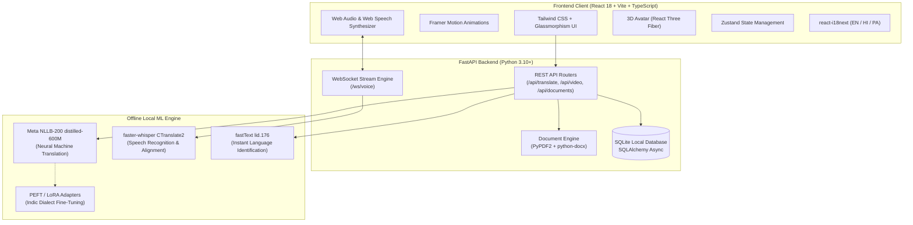

<div align="center">

# 🌐 LinguaBridge

### Enterprise-Grade Offline Neural Translation & Multimedia Intelligence Studio

[](https://python.org)
[](https://fastapi.tiangolo.com)
[](https://react.dev)
[](https://typescriptlang.org)
[](https://tailwindcss.com)
[](#-ml-architecture)
[](LICENSE)

*A privacy-first, 100% offline neural translation studio powered by Meta's NLLB-200 and OpenAI's Whisper. Features real-time multi-speaker voice conversations with tone & age modulation, cinema-grade dual-subtitle video captioning, and structured document translation.*

[Key Features](#-key-features) • [Architecture](#-architecture) • [Quick Start](#-quick-start) • [API Reference](#-api-reference) • [ML Models](#-ml-models) • [Roadmap](#-roadmap)

</div>

---

## 🌟 What Makes LinguaBridge Unique?

Most modern translation tools rely on cloud APIs (Google Cloud, OpenAI, DeepL), which introduce latency, recurring billing, privacy risks, and poor handling of regional Indian dialects. **LinguaBridge is built from the ground up to solve this:**

1. **🔒 100% Offline & Zero Cloud Dependency**: All neural inference runs entirely on your local machine. No external API keys, no telemetry, and zero recurring cloud costs.
2. **🎙️ Adaptive Voice-to-Voice Conversation Studio**: Real-time bi-directional conversation with auto-language switching, individual Speaker A/B voice selection (Male/Female), age modulation (Young/Natural/Mature), and cultural tone modulation (Casual, Formal, Natural, Indian Tone).
3. **🇮🇳 Authentic Indic Dialect & Cultural Fidelity**: Built-in Gurmukhi phonetics, Devanagari transliteration, and greeting normalization (e.g., auto-converting literal transliterations to authentic Punjabi *"ਸਤਿ ਸ੍ਰੀ ਅਕਾਲ"*).
4. **🎬 Cinema Video Captioning Studio**: High-accuracy Whisper transcription combined with NLLB alignment, delivering dual subtitles (Original + Translated), timestamp seeking, and one-click SRT/VTT/TXT exports.
5. **📄 Structured Document Translation**: Side-by-side dual-panel preview that parses and preserves paragraph structures across PDF, DOCX, and TXT files with instant multi-format downloads.
6. **🤖 3D Sign Language Accessibility Studio**: Procedural 3D avatar designed for synchronized sign language interpretation (ASL/ISL).

---

## ✨ Key Features

| Studio Mode | Description | Key Capabilities |
|-------------|-------------|------------------|
| 🔤 **Text Translation** | Real-time debounced neural translation across 63+ languages | Auto-detect language, confidence score, copy to clipboard, swap languages |
| 🎙️ **Voice Translation** | Continuous speech-to-text with instant voice synthesis | Live audio waveform, single-playback guarantee, zero echo/loopback |
| 💬 **Conversation Studio** | Two-person split-screen dialogue system | Speaker A & B personas, Male/Female pitch, Young/Mature age filter, Indian Tone |
| 🎬 **Video Studio** | Audio extraction, AI transcription & subtitle alignment | Dual subtitles (Original + Translated), cinema player, interactive transcript, SRT/VTT/TXT export |
| 📄 **Document Translation** | Document parser and layout-preserving translator | Side-by-side page preview, paragraph breakdown, export as DOCX, PDF, or TXT |
| 🤖 **3D Sign Avatar** | Procedural 3D avatar for deaf and hard-of-hearing accessibility | React Three Fiber, ASL/ISL gloss sequences, timeline synchronization |
| 🔬 **Model Lab** | Model benchmarking & evaluation suite | Side-by-side BLEU, chrF++, and METEOR metric charts (Base NLLB vs LoRA fine-tune) |
| 📊 **Analytics Dashboard** | Local translation telemetry and stats | Total words translated, latency tracking, daily volume trends, top language pairs |

---

## 🏗️ Architecture



---

## 📁 Project Structure

```
LinguaBridge/
├── frontend/                         # React 18 + Vite + TypeScript client
│   ├── src/
│   │   ├── components/
│   │   │   ├── layout/               # Header, Sidebar, MobileNav
│   │   │   ├── translation/          # LanguagePicker, WaveformVisualizer
│   │   │   ├── video/                # VideoCaptioning, CinemaPlayer, TranscriptPanel, ExportPanel
│   │   │   └── common/               # CommandPalette, ErrorBoundary, GlassCards
│   │   ├── pages/
│   │   │   ├── TranslatorPage.tsx    # Text, Voice, Conversation & Document studios
│   │   │   ├── VideoStudioPage.tsx   # Video captioning & 3D avatar workspace
│   │   │   ├── ModelLabPage.tsx      # Model evaluation & BLEU/chrF++ benchmarks
│   │   │   ├── HistoryPage.tsx       # Translation history & search
│   │   │   ├── DashboardPage.tsx     # Analytics & usage visualization
│   │   │   └── SettingsPage.tsx      # Theme, voice persona & model settings
│   │   ├── store/                    # Zustand stores (translation, video, settings)
│   │   ├── lib/                      # API client, TTS engine, Gurmukhi phonetics
│   │   └── i18n/                     # English, Hindi, and Punjabi locale files
│   └── vite.config.ts
│
├── backend/                          # FastAPI Python backend
│   ├── app/
│   │   ├── main.py                   # FastAPI application factory & lifespan
│   │   ├── config.py                 # Pydantic Settings & environment config
│   │   ├── database.py               # Async SQLAlchemy database engine
│   │   ├── ml/
│   │   │   ├── model_manager.py      # Pre-loading & singleton ML model manager
│   │   │   └── languages.py          # 63 supported languages metadata
│   │   ├── routers/                  # translation, voice, video, documents, history, analytics
│   │   └── services/
│   │       ├── translation.py        # NLLB translation, tone modulation & colloquial maps
│   │       ├── video_processor.py    # Two-pass Whisper transcription & subtitle pipeline
│   │       ├── document.py           # Multi-format document parser & translator
│   │       └── subtitle.py           # SRT, VTT, and dual-subtitle generator
│   └── requirements.txt
│
├── ml/                               # Fine-tuning & evaluation pipeline
│   ├── configs/training_config.yaml  # LoRA / PEFT hyperparameters
│   ├── scripts/
│   │   ├── finetune_nllb.py          # LoRA fine-tuning for Indic language pairs
│   │   ├── evaluate_model.py         # BLEU, chrF++, METEOR validation
│   │   └── export_ctranslate2.py     # Quantize model to int8 for ultra-fast CPU inference
│   └── model_card.md                 # Evaluation benchmarks & metrics
│
├── docker-compose.yml                # Containerized local deployment
├── start.bat                         # One-click Windows launcher
├── start.sh                          # One-click Linux/macOS launcher
└── README.md                         # Project documentation
```

---

## 🚀 Quick Start

### Prerequisites
- **Python 3.10+** (Python 3.12 recommended)
- **Node.js 18+** (Node.js 20 recommended)
- **ffmpeg** (Optional, required for video audio extraction)

### ⚡ One-Click Startup

**On Windows:**
```cmd
git clone https://github.com/vivek-ash/LinguaBridge.git
cd LinguaBridge
start.bat
```

**On Linux / macOS:**
```bash
git clone https://github.com/vivek-ash/LinguaBridge.git
cd LinguaBridge
chmod +x start.sh
./start.sh
```

---

### 🛠️ Manual Step-by-Step Setup

#### 1. Clone the repository
```bash
git clone https://github.com/vivek-ash/LinguaBridge.git
cd LinguaBridge
cp .env.example .env
```

#### 2. Backend Setup
```bash
cd backend
python -m venv venv

# Windows
venv\Scripts\activate
# Linux / macOS
source venv/bin/activate

pip install -r requirements.txt
python seed_data.py
python -m uvicorn app.main:app --host 0.0.0.0 --port 8000 --reload
```

#### 3. Frontend Setup
```bash
cd ../frontend
npm install
npm run dev -- --host 0.0.0.0 --port 5173
```

#### 4. Open in Browser
Open **[http://localhost:5173](http://localhost:5173)** in your browser. The backend API documentation is available at **[http://localhost:8000/docs](http://localhost:8000/docs)**.

---

### 🐳 Docker Deployment

```bash
docker-compose up --build
```

---

## 🤖 ML Architecture & Models

LinguaBridge works immediately out of the box in fallback mode, and automatically warms up full neural models when present:

| Component | Model | Purpose | Memory | Download |
|-----------|-------|---------|--------|----------|
| **Translation** | [NLLB-200-distilled-600M](https://huggingface.co/facebook/nllb-200-distilled-600M) | 200-language translation | ~1.2 GB | Auto-download on start |
| **Speech-to-Text** | [faster-whisper](https://github.com/SYSTRAN/faster-whisper) (medium/base) | Audio transcription & timing | ~300 MB - 1.5 GB | Cached locally in `models_cache` |
| **Detection** | [fastText lid.176](https://fasttext.cc/docs/en/language-identification.html) | Instant language detection | ~130 MB | Auto-cached |
| **Fine-Tuning** | LoRA / PEFT Adapters | Indic dialect specialization | ~40 MB | Optional via `ml/` |

> 💡 **Hardware Acceleration**: Set `USE_GPU=auto` in `.env`. LinguaBridge automatically leverages NVIDIA CUDA if detected; otherwise, it defaults to high-performance multi-threaded CPU inference.

---

## 🔌 API Reference

The FastAPI backend provides interactive OpenAPI documentation at **[http://localhost:8000/docs](http://localhost:8000/docs)**.

| Method | Endpoint | Description |
|:------:|:---------|:------------|
| `POST` | `/api/translate` | Translate text with tone modulation and language metadata |
| `POST` | `/api/detect` | Identify language with confidence score |
| `GET`  | `/api/languages` | List all 63 supported languages |
| `WS`   | `/ws/voice` | Low-latency bi-directional voice streaming |
| `POST` | `/api/video/caption` | Upload video for high-accuracy Whisper transcription |
| `GET`  | `/api/video/status/{job_id}` | Poll asynchronous video processing pipeline status |
| `GET`  | `/api/video/result/{job_id}` | Retrieve synchronized subtitle segments |
| `GET`  | `/api/video/export/{job_id}/{fmt}` | Download subtitles (`srt`, `vtt`, `transcript`) |
| `POST` | `/api/documents/parse` | Parse uploaded document structure (PDF, DOCX, TXT) |
| `POST` | `/api/documents/translate` | Translate parsed pages paragraph-by-paragraph |
| `GET`  | `/api/documents/export/{id}/{fmt}`| Export translated document as DOCX, PDF, or TXT |
| `GET`  | `/api/history` | Query searchable translation history |
| `GET`  | `/api/analytics/summary` | Query usage telemetry and statistics |

---

## 🌍 Supported Languages (63+)

<details>
<summary><b>Click to expand full language directory</b></summary>

### 🇮🇳 Indian Languages:
- Hindi (हिन्दी)
- Punjabi (ਪੰਜਾਬੀ)
- Bengali (বাংলা)
- Marathi (मराठी)
- Tamil (தமிழ்)
- Telugu (తెలుగు)
- Gujarati (ગુજરાતી)
- Kannada (ಕನ್ನಡ)
- Malayalam (മലയാളം)
- Odia (ଓଡ଼ିଆ)
- Urdu (اردو)
- Nepali (नेपाली)
- Assamese (অসমীয়া)
- Sanskrit (संस्कृतम्)

### 🌐 Global Languages:
English, Spanish, French, German, Italian, Portuguese, Russian, Chinese (Simplified & Traditional), Japanese, Korean, Arabic, Turkish, Dutch, Swedish, Norwegian, Danish, Finnish, Polish, Czech, Romanian, Hungarian, Greek, Hebrew, Persian (Farsi), Ukrainian, Thai, Vietnamese, Indonesian, Malay, Tagalog, and more.

</details>

---

## ⌨️ Productivity Shortcuts

| Shortcut | Action |
|:---------|:-------|
| `Ctrl + K` / `Cmd + K` | Open universal Command Palette |
| `Ctrl + Enter` | Trigger translation |
| `Ctrl + Shift + S` | Swap source & target languages |
| `Ctrl + Shift + C` | Copy translation to clipboard |
| `Ctrl + Shift + D` | Toggle Dark / Light theme |

---

## 🧪 Testing & Verification

Run the comprehensive automated test suite:

```bash
cd backend
python -m pytest tests/ -v
```

```bash
cd frontend
npm run build
```

---

## 🗺️ Roadmap & Future Vision

- [x] 100% Offline AI neural translation engine (NLLB-200)
- [x] Real-time voice conversation mode with tone & age modulation
- [x] Pure Punjabi & Indic phonetic accuracy with authentic greeting maps
- [x] High-accuracy cinema video captioning with dual subtitle export
- [x] Structured dual-panel document translation (PDF, DOCX, TXT)
- [ ] 3D Humanoid realistic sign language avatar (ISL, ASL, BSL)
- [ ] On-device camera OCR translation (Tesseract / EasyOCR)
- [ ] Progressive Web App (PWA) offline installation
- [ ] Cross-platform mobile companion app (React Native)

---

## 📄 License

This project is licensed under the **MIT License** — see the [LICENSE](LICENSE) file for details.

---

<div align="center">

**Made with ❤️ for breaking language barriers without compromising privacy.**

[⬆ Back to Top](#-linguabridge)

</div>
